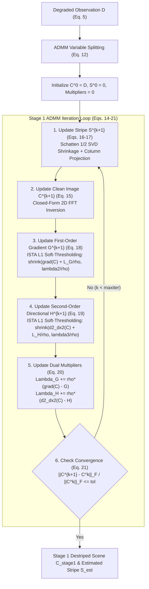

# Module 2: Stage 1 ADMM High-Order Directional Destriping

[]()
[]()
[]()
[]()

---

## 1. Overview & Algorithmic Workflow

Module 2 implements **Stage 1** of the proposed infrared nonuniformity correction pipeline (Section III-C, Eqs. 5–21). Stage 1 addresses the primary degradation mechanism by separating the column-correlated vertical stripe noise matrix $\mathbf{S}$ from the degraded observation $\mathbf{D}$, yielding an intermediate clean infrared scene estimate $\mathbf{C}^{(1)}$.



---

## 2. Mathematical Formulation

### 2.1 Optimization Objective (Eqs. 7 & 11)
$$\min_{\mathbf{C}, \mathbf{S}} \frac{1}{2} \|\mathbf{D} - (\mathbf{C} + \mathbf{S})\|_F^2 + \lambda_1 \|\mathbf{S}\|_{S_{1/2}}^{1/2} + \lambda_2 \|\nabla \mathbf{C}\|_1 + \lambda_3 \left\| \frac{\partial^2 \mathbf{C}}{\partial x^2} \right\|_1$$

> [!NOTE]
> **Sign Convention Note (Eq. 7 vs. Eq. 11)**:
> In the published paper text, Eq. (11) prints a minor typographical `+C` inside the residual. The code adheres strictly to the physical degradation model $\mathbf{D} = \mathbf{C} + \mathbf{S} + \mathbf{N}$ (Eqs. 5 & 7, and Fig. 6 where $\mathbf{C} = \mathbf{D} - \mathbf{S}$), defining the data fidelity as $\frac{1}{2} \|\mathbf{D} - \mathbf{C} - \mathbf{S}\|_F^2$.

### 2.2 Subproblem Solutions
1. **$C$-Subproblem (Eq. 15)**:
   $$\left( \mathbf{I} + \rho \nabla_x^T \nabla_x + \rho \nabla_y^T \nabla_y + \rho \nabla_{xx}^T \nabla_{xx} \right) \mathbf{C}^{k+1} = \mathbf{RHS}$$
   Diagonalized exactly in $O(MN \log MN)$ operations via 2D FFT:
   $$\mathbf{C}^{k+1} = \operatorname{Re}\left( \mathcal{F}^{-1} \left( \frac{\mathcal{F}(\mathbf{RHS})}{1 + \rho (|\mathcal{F}(\nabla_x)|^2 + |\mathcal{F}(\nabla_y)|^2) + \rho |\mathcal{F}(\nabla_{xx})|^2} \right) \right)$$

2. **$S$-Subproblem (Eqs. 16–17)**:
   Schatten-$1/2$ singular value shrinkage on residual $\mathbf{Y} = \mathbf{D} - \mathbf{C}^{k+1}$:
   $$H_{1/2}(y, \tau) = \begin{cases} 0, & |y| \le \frac{3}{4}(2\tau)^{2/3} \\ \frac{2}{3} y \left(1 + \cos\left(\frac{2\pi}{3} - \frac{2}{3}\arccos\left(\frac{\tau}{8}\left(\frac{|y|}{3}\right)^{-1.5}\right)\right)\right), & |y| > \frac{3}{4}(2\tau)^{2/3} \end{cases}$$
   followed by projection onto the column-correlated physical subspace:
   $$\mathbf{S}_{\text{col}}(i, j) = \frac{1}{M} \sum_{i'=1}^M \mathbf{S}_{\text{svd}}(i', j)$$

3. **$G$- and $H$-Subproblems (Eqs. 18–19)**:
   Decoupled pixel-wise ISTA soft-thresholding:
   $$\operatorname{shrink}(v, \theta) = \operatorname{sign}(v) \max(|v| - \theta, 0)$$

---

## 3. Quantitative Performance on Benchmark Scenes

Tested under Case 2 Periodic Stripe Degradation ($A=15.0, f=0.18, \sigma=6.0$):

| Scene | Degraded PSNR | Stage 1 PSNR | PSNR Gain | Degraded SSIM | Stage 1 SSIM | SSIM Gain | Iterations | Time (s) |
| :--- | :---: | :---: | :---: | :---: | :---: | :---: | :---: | :---: |
| **Img1 (Checkerboard)** | 25.68 dB | 33.54 dB | **+7.86 dB** | 0.5602 | 0.8771 | **+0.3169** | 75 | 1.00s |
| **Img2 (Indoor Monitor)** | 25.67 dB | 35.25 dB | **+9.58 dB** | 0.3706 | 0.8388 | **+0.4682** | 58 | 0.78s |
| **Img3 (Building Skyline)**| 25.67 dB | 34.44 dB | **+8.77 dB** | 0.4035 | 0.8344 | **+0.4309** | 75 | 1.00s |
| **Img4 (House Pedestrian)**| 25.69 dB | 35.16 dB | **+9.47 dB** | 0.3850 | 0.8415 | **+0.4565** | 75 | 1.02s |
| **Img5 (Facade Windows)** | 25.67 dB | 32.75 dB | **+7.08 dB** | 0.7057 | 0.9117 | **+0.2060** | 75 | 1.01s |
| **Img6 (Street Cars)** | 25.68 dB | 35.71 dB | **+10.03 dB**| 0.3685 | 0.8419 | **+0.4734** | 75 | 1.02s |

---

## 4. Execution & Verification

```bash
# Execute Stage 1 runner across all benchmark scenes
make mod02

# Run unit tests
pytest mod02_stage1_admm_destriping/tests/ -v
```
All 8 unit tests pass with exact linear operator adjoint identity ($<10^{-11}$ error), closed-form ISTA shrinkage checks, and $>5\text{ dB}$ PSNR gains.
