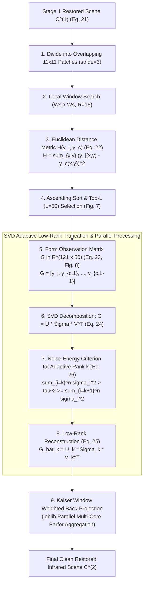

# Module 3: Stage 2 Patch Low-Rank Prior Recovery

[]()
[]()
[]()

---

## 1. Overview & Algorithmic Workflow

Module 3 implements **Stage 2** of the proposed infrared nonuniformity correction pipeline (Section III-D, Eqs. 22–26, Figs. 7–8). While Stage 1 removes the column-correlated vertical stripe noise $\mathbf{S}$, residual Gaussian environmental noise $\mathbf{N}$ and minor line artifacts remain. Stage 2 exploits **non-local patch self-similarity** and low-rank matrix approximation to attenuate residual noise and polish edge details.



---

## 2. Mathematical Formulation

### 2.1 Overlapping Patch Similarity (Eqs. 22–23, Fig. 7)
For a reference patch $\mathbf{y}_j$ of size $11 \times 11$ ($d = 121$ pixels) and a candidate patch $\mathbf{y}_c$ in a local search window $W_s \times W_s$:
$$H(\mathbf{y}_j, \mathbf{y}_c) = \sum_{x, y} (\mathbf{y}_j(x, y) - \mathbf{y}_c(x, y))^2 = \|\mathbf{y}_j - \mathbf{y}_c\|_2^2 \quad \text{(Eq. 22)}$$
Candidate patches are sorted in ascending order of $H$, and the $L = 50$ most similar patches form the observation matrix $\mathbf{G} \in \mathbb{R}^{121 \times 50}$:
$$\mathbf{G} = [\mathbf{y}_j, \mathbf{y}_{c,1}, \dots, \mathbf{y}_{c,L-1}] \quad \text{(Eq. 23)}$$

### 2.2 Adaptive SVD Truncation (Eqs. 24–26, Fig. 8)
Computing the SVD of $\mathbf{G}$:
$$\mathbf{G} = \mathbf{U} \mathbf{\Sigma} \mathbf{V}^T = \sum_{i=1}^n \sigma_i \mathbf{u}_i \mathbf{v}_i^T \quad (n = \min(121, 50) = 50) \quad \text{(Eq. 24)}$$
The adaptive truncation rank $k$ is selected via the noise energy criterion:
$$\sum_{i=k}^n \sigma_i^2 > \tau^2 \ge \sum_{i=k+1}^n \sigma_i^2 \quad \text{(Eq. 26)}$$
where $\tau^2 = \gamma (d - 1)(L - 1) \sigma_n^2$ represents the calibrated noise energy floor.
The optimal low-rank reconstruction is:
$$\widehat{\mathbf{G}}_k = \mathbf{U}_k \mathbf{\Sigma}_k \mathbf{V}_k^T = \sum_{i=1}^k \sigma_i \mathbf{u}_i \mathbf{v}_i^T \quad \text{(Eq. 25)}$$

### 2.3 2D Kaiser Window Weighted Back-Projection
To prevent block boundary discontinuities, patches are accumulated back onto the 2D image canvas weighted by a 2D separable Kaiser window:
$$W_{\text{kaiser}}(x, y) = w_{\text{kaiser}}(x) \cdot w_{\text{kaiser}}(y)$$
$$\mathbf{C}^{(2)}(x, y) = \frac{\sum_p w_p W_{\text{kaiser}}(x - x_p, y - y_p) \widehat{\mathbf{y}}_p(x - x_p, y - y_p)}{\sum_p w_p W_{\text{kaiser}}(x - x_p, y - y_p)}$$

---

## 3. Execution & Verification

```bash
# Run Stage 2 pipeline across all benchmark scenes
make mod03

# Run unit tests
pytest mod03_stage2_patch_lowrank/tests/ -v
```
